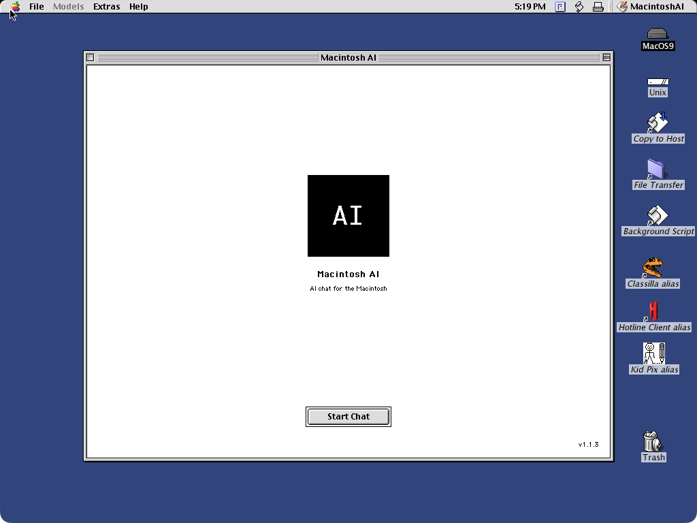
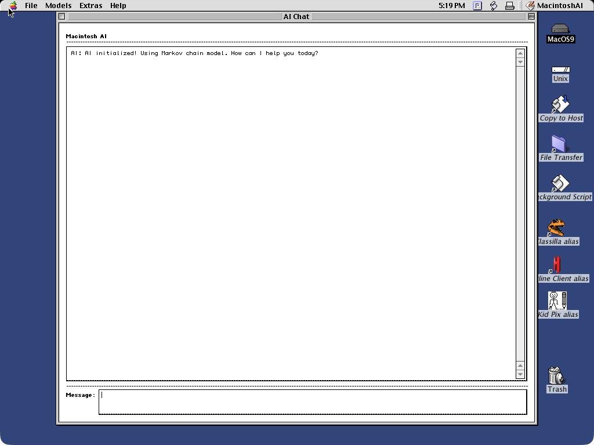

# Macintosh AI

An AI chat client for a 68k Classic Macintosh. It talks to Anthropic, OpenAI,
Gemini, OpenRouter or any OpenAI-compatible endpoint over HTTPS directly from
System 7 — no bridge machine, no proxy — and falls back to two offline models
when there is no network.




## What works

- **Remote AI, streamed.** Requests go out from the Mac over TLS 1.3 using a
  vendored, 68k-tuned mbedTLS 3.2.1 stack (the engine behind
  [Claude 68](https://github.com/SLKK-design/Claude68)). Tokens are decoded as
  they arrive from the Server-Sent Events stream and appear in the chat window
  as they are produced, so the UI never blocks on the network.
- **Five providers.** Anthropic, OpenAI, Gemini, OpenRouter and any
  OpenAI-compatible endpoint; the exact URL and auth header for each are in
  [Providers](#providers).
- **Offline fallbacks.** A Markov chain and a template/pattern model still run
  with no network at all. Pick one from the **Models** menu.
- **Settings that persist.** File ▸ Settings… stores provider, model, API key
  and base URL in `MacintoshAI Prefs` in the Preferences folder; the
  `tls_verify` setting lives in the same file.

## Requirements

| | |
|---|---|
| CPU | 68020 or later (the TLS engine uses 68020 multiply instructions) |
| RAM | 8 MB minimum; the app asks for a 3 MB partition |
| System | System 7.5.3 or later |
| Network | Open Transport 1.3 or later, with TCP/IP configured |

The 3 MB partition is not generous: the offline Markov and template models are
about 940 KB of statics, the 68k code is another 600 KB, and the engine reserves
128 KB of stack before enlarging the heap. A 2 MB partition makes Mac OS 9 fail
the launch at startup with no alert, which is what the emulator test caught.

Open Transport is the supported transport. A MacTCP build remains available for
7.0.1 machines (`make build NET68K_TRANSPORT=mactcp`); it is not exercised by
CI and is not tested here — use it only if you must.

## Download

Every tagged release on the
[Releases page](../../releases) contains:

- `MacintoshAI.dsk` — a bootable/installable disk image; open it with an
  emulator or copy `MacintoshAI` onto a real Mac.
- `MacintoshAI.bin` — the raw application, for `LaunchAPPL`, emulators, or
  disk-image tools.
- `MacintoshAI-<tag>-68k.sit` — a StuffIt archive that preserves the resource
  fork, which is what you want when downloading onto a modern machine and
  moving the file to a Mac.

A bare `.dsk` cannot be opened from a browser on a modern Mac; use the `.sit`.

## Building

All builds run inside the Retro68 cross-compiler image. A clean tree, one
command:

```bash
docker run --rm \
  -v "$PWD:/root/work" \
  -v "$HOME/Documents/SendToMacOS9:/ial:ro" \
  -w /root/work \
  -e APP_VERSION_STR="$(git describe --tags --always --dirty)" \
  ghcr.io/autc04/retro68 bash -lc \
  'make build APP_NAME=MacintoshAI \
     IAL_DIR="/ial/MPW/MPW-GM+PR+Final Updates/Interfaces&Libraries"'
```

Artifacts land in `dist/`: `MacintoshAI.dsk` (800K HFS image with the app),
`MacintoshAI.bin` (MacBinary, the application itself), and the AppleDouble
`%MacintoshAI.ad` that carries the resource fork. (`MacintoshAI.APPL` in the
build directory is an empty placeholder, not the app.)

The build first stages Apple's Universal Interfaces & Libraries into the
Retro68 toolchain and builds **everything** against them. That is not
optional: Retro68 ships only the open-source Multiversal subset (44 headers),
which has no `Controls.h`, `Lists.h`, `Scrap.h`, `Script.h` or `Threads.h`,
and no `MacTCP.h` or Open Transport at all. `make universal` does the staging;
`make build` depends on it.

The default `IAL_DIR` is
`$HOME/Documents/SendToMacOS9/MPW/MPW-GM+PR+Final Updates/Interfaces&Libraries`;
override it when yours lives elsewhere. On macOS, `$HOME/Documents` is often
shared into the emulator image as `/Users/<you>/Documents`, so the mount above
is a one-liner only if you keep that layout — adjust the two paths together.

On a machine with Retro68 installed natively:

```bash
make build      # cmake configure + build, then copy artifacts to dist/
make universal  # re-stage Apple's Universal Interfaces (only when needed)
make debug-build
make run        # LaunchAPPL -e minivmac, if LaunchAPPL.cfg is set up
make clean
make format     # clang-format
make lint       # clang-tidy over the compilation database
```

Host unit tests for the stream decoder and other Toolbox-free logic:

```bash
tests/host/run.sh
```

## Using it

Start the app, click **Start Chat**, pick a model from the **Models** menu:
Remote AI uses the configured provider, Markov and Template work offline.

**File ▸ Settings…** (⌘,) opens the settings dialog:

- **Provider** — one of `anthropic`, `openai`, `gemini`, `openrouter`,
  `compatible`, case-insensitive. See [Providers](#providers) for defaults.
- **Model** — e.g. `claude-sonnet-4-5`, `gpt-4o-mini`, `gemini-2.0-flash`.
  Empty means the selected provider's default model.
- **API key** — paste it with the keyboard; nothing is echoed beyond the field.
- **Base URL** — leave empty for the provider default. Accepts
  `https://host[:port][/path]`; only `https://` URLs are accepted. The path is
  joined with the provider's endpoint path, so `https://gateway.example/v1`
  becomes `https://gateway.example/v1/chat/completions` rather than a doubled
  `/v1`. `compatible` requires a base URL and a model.

## Providers

The `provider` pref (and the Settings field) selects one of these; the value is
also the name written to `MacintoshAI Prefs`.

| `provider` | Dialect | Endpoint it posts to | Auth | Default model |
|---|---|---|---|---|
| `anthropic` | Anthropic Messages | `POST https://api.anthropic.com/v1/messages` | `x-api-key` plus `anthropic-version: 2023-06-01` | `claude-sonnet-4-5` |
| `openai` | OpenAI chat completions | `POST https://api.openai.com/v1/chat/completions` | `Authorization: Bearer` | `gpt-4o-mini` |
| `gemini` | Gemini streams | `POST https://generativelanguage.googleapis.com/v1beta/models/gemini-2.0-flash:streamGenerateContent?alt=sse` | `x-goog-api-key` | `gemini-2.0-flash` |
| `openrouter` | OpenAI chat completions | `POST https://openrouter.ai/api/v1/chat/completions` | `Authorization: Bearer`, plus `HTTP-Referer` and `X-Title` | `anthropic/claude-sonnet-4.5` |
| `compatible` | OpenAI chat completions | `POST {base}/v1/chat/completions` | `Authorization: Bearer` | none — a model must be entered |

Anthropic sends `{"model","max_tokens":1024,"stream":true,"messages":[…]}`.
The OpenAI-dialect providers send `{"model","stream":true,"messages":[…]}`.
Gemini sends `{"contents":[{"role":"user"|"model","parts":[{"text":…}]}]}` and
puts the model in the URL. Assistant turns are mapped to `assistant` or, for
Gemini, `model`.

**Certificate verification is pinned to two Google Trust Services
intermediates.** WE1 covers `api.anthropic.com`, `api.openai.com` and
`openrouter.ai`; WE2 covers `*.googleapis.com`, so `gemini` verifies too.
Arbitrary `compatible` servers present chains that include neither, so they
fail closed with `<provider>: TLS: certificate not trusted` until their anchor
is added to the engine. Setting `tls_verify=0` in `MacintoshAI Prefs` makes the
app trust **any** certificate — the Settings dialog does not expose the switch,
so this is a hand edit; only do it on a network you control. The status strip
then reads `Remote AI · TLS: no cert check`.

## Security limitations

Read these before putting a real key in:

- **The API key is stored in plain text** in `MacintoshAI Prefs` on the Mac.
  Without the Keychain there is nothing better available on System 7; treat the
  machine as holding the secret.
- **The trust anchors are the Google Trust Services WE1 and WE2
  intermediates**, pinned directly (computing the P-384 root signature does not
  fit in the handshake budget). WE1 covers `api.anthropic.com`,
  `api.openai.com` and `openrouter.ai`; WE2 covers `*.googleapis.com`
  (`gemini`). The pinned certificates **expire 2029-02-20**; after that date
  the app cannot connect until the anchors are replaced with a new build.
- **Certificate dates are not checked** (`MBEDTLS_HAVE_TIME_DATE` is off) and
  there is **no revocation checking**. The pinned anchors limit the blast
  radius, but an expired intermediate would still be accepted before its
  removal, and a revoked one would too.
- **Other `compatible` hosts are not covered by either anchor.** Their chains
  do not include WE1 or WE2, so they fail closed with
  `<provider>: TLS: certificate not trusted` until their anchor is added to the
  engine. `tls_verify=0` disables verification for those endpoints, at the cost
  of trusting any certificate on the path.

## Repository layout

```
src/            application (UI, chat models, prefs, API client)
libs/net68k/    vendored TLS/HTTP engine, Open Transport + MacTCP transports
tests/host/     Toolbox-free unit tests
tests/emulator/ SheepShaver-driven smoke tests (local only)
```

Third-party components and their licenses are listed in
[THIRD-PARTY-NOTICES.md](THIRD-PARTY-NOTICES.md).

## License

MIT — see [LICENSE](LICENSE).
